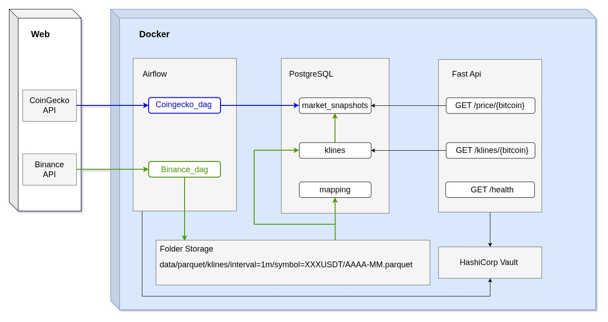
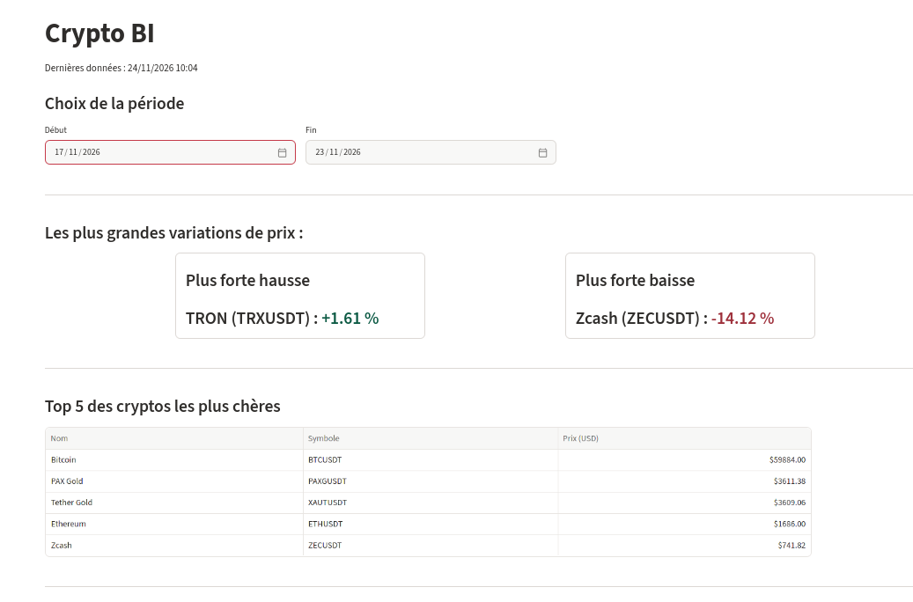
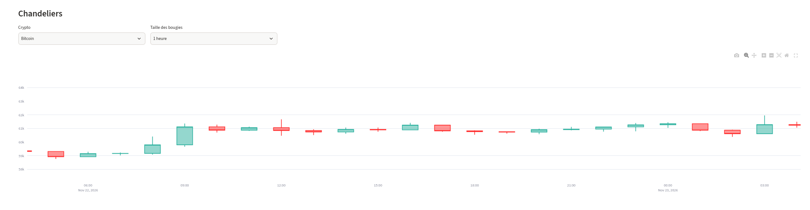

# ⚙️ Crypto Trading Pipeline

Pipeline de données pour collecter, stocker et servir les données de marché de plus de **50 cryptomonnaies** :  
prix à la minute (CoinGecko) et historique de bougies 1 minute (Binance), exposés via une API REST.


---

## 📌 Contexte

Analyser les cryptomonnaies nécessite des données multi-sources fiables.  
Ce projet agrège des flux hétérogènes (prix, volume, market cap, bougies) issus de plusieurs APIs publiques gratuites, avec :

- une **collecte automatisée et résiliente** (retries, reprise incrémentale) ;
- un **stockage hybride** : PostgreSQL pour le récent, Parquet pour l'historique ;
- une **API de serving** à faible latence.

## 🎯 Objectifs et résultats

| Critère | Objectif | Résultat |
|---------|----------|----------|
| Fréquence de collecte | CoinGecko toutes les minutes ; Binance quotidien (incrémental) | ✅ DAGs en production locale |
| Retry logic | Gestion automatique des erreurs API | ✅ Retries Airflow + retries/rate limit côté client HTTP |
| Latence API | < 200 ms | ✅ **~14 ms (1 jour) / ~50 ms (7 jours)** de médiane |
| Disponibilité | > 99 % | ⏳ 99,71 % (sur une fenêtre de 6h)|

## 🏗️ Architecture




### Choix de conception


- **Stockage hybride** :   
PostgreSQL pour les données récentes et requêtées par l'API (`market_snapshots`, `klines` sur 7 jours glissants) ;   
Parquet partitionné par intervalle/symbole/mois pour l'historique.
- **Une tâche Airflow par paire** via le *dynamic task mapping* (`.expand()`) : isolation des erreurs et parallélisme contrôlé (`max_active_tis_per_dag`).   
Chaque tâche ne renvoie qu'un **résumé** (pas de gros volumes dans XCom).
- **Ingestion incrémentale idempotente** : backfill de 30 jours au premier passage, puis reprise à partir de la dernière bougie connue.  
 La bougie en cours est exclue, les doublons sont éliminés (fusion Parquet, `ON CONFLICT DO NOTHING` en base).
- **Correspondance CoinGecko → Binance** : 34 cryptos sur 51 ont une paire USDT en statut `TRADING` sur Binance.   
Les 17 autres sont journalisées en *warning* et restent suivies via CoinGecko uniquement.

## 🔐 Gestion des secrets

- **Aucun mot de passe applicatif dans le code ni dans `docker-compose.yml`.**  
La connexion à la base `crypto` est stockée dans **HashiCorp Vault** (`secret/connections/crypto_db`) et lue par Airflow à l'exécution des tâches  
(secrets backend Vault, `BaseHook.get_connection("crypto_db")`).
- **Vault en mode serveur** : stockage persistant (volume Docker `vault_data`), démarrage scellé, déverrouillage par `vault/start.sh`.
- **Moindre privilège** : Airflow s'authentifie par **AppRole** avec une policy en lecture seule. Le token root n'est utilisé que par le script de démarrage et pour l'administration.
- **Ce qui reste dans le `.env`** : les secrets nécessaires à Airflow avant que Vault soit lisible (clé Fernet, JWT, mot de passe de la base).
## 🛠️ Stack

| Couche | Technologie |
|--------|-------------|
| Orchestration | Apache Airflow 3.4.0 |
| Stockage | PostgreSQL 16, Parquet |
| Traitement | pandas, pyarrow |
| API | FastAPI |
| Conteneurisation | Docker Compose |
| Secrets | HashiCorp Vault (mode serveur, stockage persistant, accès Airflow via AppRole) |
| BI | Streamlit, Plotly |
| Qualité | pytest |

## 📦 Structure du projet

```
project_crypto/
├── docker-compose.yml
│
├── requirements.txt
│
├── bi/                             # app Streamlit (BI)
│   ├── Dockerfile
│   ├── requirements.txt
│   ├── db.py                       # accès Vault + requêtes PostgreSQL
│   └── app.py                      # dashboard
│
├── dags/
│   ├── coingecko_dag.py            # crypto_collect_minute (chaque minute)
│   └── binance_pipeline.py         # ingestion quotidienne des klines (chaque jour)
│
├── src/                            # PYTHONPATH=/opt/airflow/src
│   ├── extract/
│   │   ├── binance.py              # get_binance_symbols, get_klines (pagination, retries)
│   │   └── coingecko.py            # fetch_coingecko_data
│   │
│   ├── transform/
│   │   ├── models.py               # nettoyage / typage (safe_*), transform, process_coingecko_data
│   │   └── mappers.py              # get_mapper : réconciliation CoinGecko ↔ Binance
│   │
│   ├── load/
│   │   ├── parquet_io.py           # lecture/écriture Parquet
│   │   └── postgres_db.py          # insertions, purge des vieilles klines, mapping
│   │
│   └── pipelines/
│       └── ingestion.py            # ingest_pair, load_recent_klines_pipe
│  
├── api/                            # FastAPI + bench.py
│      ├── vault_config.py
│      └── main, schema, queries,...
│                         
├── storage/
│   ├──  schema.sql                 # market_snapshots, klines
│   └── bi.sql                      # schéma bi, vues, rôle bi_ro (lecture seule)
│
├── tests/                          # tests pytest
│
├── vault/
│   ├── config.hcl                  # config Vault (stockage fichier, listener HTTP)
│   ├── airflow-read.hcl            # policy : lecture seule de connections/* et variables/*
│   ├── bi-read.hcl
│   ├── start.sh                    # point d'entrée : déverrouille Vault, génère les accès Airflow, lance Docker
│   └── keys.json                   # clé de déverrouillage + token root (NON versionné)
│
├── data/                           # non versionné (Parquet)
│
└── logs/                           # non versionné
```

## 🚀 Démarrage rapide

### Prérequis

- Docker et Docker Compose
- ~4 Go de RAM et 2 CPU alloués à Docker (recommandation Airflow)

### Installation

```bash
git clone <url-du-repo>
cd <url-du-repo>

cp .env.example .env        # à compléter (voir ci-dessous)
```

Variables attendues dans `.env` (non versionné) :

| Variable | Rôle |
|----------|------|
| `POSTGRES_PASSWORD` | Mot de passe PostgreSQL |
| `FERNET_KEY` | Clé de chiffrement Airflow |
| `AIRFLOW__API_AUTH__JWT_SECRET` | Secret JWT Airflow |
| `AIRFLOW_UID` | UID Linux de l'utilisateur (`id -u`) |
| `AIRFLOW_PROJ_DIR` | `.` |
| `_AIRFLOW_WWW_USER_PASSWORD` | Mot de passe de l'admin Airflow |
| `_PIP_ADDITIONAL_REQUIREMENTS` | "pytest apache-airflow-providers-hashicorp"|

> Les valeurs contenant des espaces ou des caractères spéciaux (`$ & ; ( ) ! #`) doivent être entre guillemets, car `start.sh` lit ce fichier avec `source`.

### Première installation de Vault

Les secrets applicatifs (connexion à la base `crypto`) sont dans Vault, pas dans le `.env`.
Prérequis : `jq`.

```bash
# 1. Démarrer Vault seul (il démarre vide et scellé)
docker compose up -d vault

# 2. Initialiser : 1 clé de déverrouillage, 1 nécessaire. Affichée une seule fois, enregistrée dans keys.json
docker compose exec -T vault vault operator init -key-shares=1 -key-threshold=1 -format=json > vault/keys.json
chmod 600 vault/keys.json          # fichier déjà dans .gitignore ; en faire aussi une copie à l'abri

# 3. Déverrouiller, créer le moteur de secrets, le secret, la policy et l'AppRole
set -a; source .env; set +a
export UNSEAL_KEY=$(jq -r '.unseal_keys_b64[0]' vault/keys.json)
export VAULT_TOKEN=$(jq -r '.root_token' vault/keys.json)

docker compose exec -T -e UNSEAL_KEY vault sh -c 'vault operator unseal "$UNSEAL_KEY"'
docker compose exec -T -e VAULT_TOKEN vault vault secrets enable -path=secret kv-v2
docker compose exec -T -e VAULT_TOKEN -e POSTGRES_PASSWORD vault sh -c 'vault kv put -mount=secret connections/crypto_db conn_type=postgres host=postgres port=5432 login=airflow password="$POSTGRES_PASSWORD" schema=crypto'
docker compose exec -T -e VAULT_TOKEN vault vault policy write airflow-read - < vault/airflow-read.hcl
docker compose exec -T -e VAULT_TOKEN vault vault auth enable approle
docker compose exec -T -e VAULT_TOKEN vault vault write auth/approle/role/airflow token_policies=airflow-read token_ttl=720h token_max_ttl=720h secret_id_ttl=0

unset UNSEAL_KEY VAULT_TOKEN
```

### Démarrage

```bash
./vault/start.sh
```

Le script :
1. lit le `.env` ;
2. démarre Vault et le **déverrouille** si besoin (Vault redémarre scellé, par exemple après un redémarrage du PC) ;
3. génère de nouveaux identifiants AppRole pour Airflow (accès en **lecture seule**, le token root ne sert qu'ici) ;
4. lance tous les autres services avec `docker compose up -d`.

> Utiliser `./vault/start.sh` à la place de `docker compose up`. Sans lui, Vault reste scellé et les tâches échouent.

```bash
# Vérifier que les services sont healthy
docker compose ps
```

> 🔐 Ni `.env`, ni `vault/keys.json`, ni `data/` ne sont versionnés (`.gitignore`).

### Accès

| Service | URL |
|---------|-----|
| Airflow UI | http://localhost:8080 |
| API FastAPI | http://localhost:8000 |
| API Swagger UI (Doc API) | http://localhost:8000/docs |
| Streamlit | http://localhost:8501 |
| Vault UI (administration) | http://127.0.0.1:8200 (token root dans `vault/keys.json`) |


## 🔌 API

Documentation interactive (Swagger UI) : http://localhost:8000/docs

| Route | Description |
|-------|-------------|
| `GET /`| Page d'accueil|
| `GET /health`| Status de l'API|
| `GET /price/{coin_id}` | Dernier prix CoinGecko collecté pour une crypto |
| `GET /klines/{coin_id}` | Bougies 1 minute Binance d'une crypto sur une période |

`coin_id` est l'identifiant CoinGecko (ex. `bitcoin`) : 1 à 64 caractères parmi `a-z`, `0-9` et `-`.

### `GET /price/{coin_id}`

```bash
curl "http://localhost:8000/price/bitcoin"
```

```json
{
  "coin_id": "bitcoin",
  "current_price": "61446",
  "collected_at": "2026-11-20T13:29:01Z"
}
```

| Champ | Type | Description |
|-------|------|-------------|
| `coin_id` | string | Identifiant CoinGecko |
| `current_price` | string | Dernier prix en USD (chaîne, pour conserver la précision décimale) |
| `collected_at` | datetime (UTC) | Horodatage de la collecte |

### `GET /klines/{coin_id}`

Retourne les bougies 1 minute d'une crypto sur une période.

```bash
curl "http://localhost:8000/klines/bitcoin?start=2026-11-20T09:00:00Z&end=2026-11-20T09:03:00Z"
```

| Paramètre | Description |
|-----------|-------------|
| `coin_id` | Identifiant CoinGecko (dans l'URL) |
| `start`, `end` | Bornes ISO 8601 avec fuseau, en UTC (`end` exclue). `start` doit être antérieur à `end`, et la période ne peut pas dépasser **7 jours** |

```json
{
  "coin_id": "bitcoin",
  "symbol": "BTCUSDT",
  "count": 3,
  "candles": [
    {
      "open_time": "2026-11-20T09:00:00Z",
      "open": 61833.19,
      "high": 61854.05,
      "low": 61813.1,
      "close": 61846.68,
      "volume": 5.2798
    }
  ]
}
```

| Champ | Type | Description |
|-------|------|-------------|
| `coin_id` | string | Identifiant CoinGecko |
| `symbol` | string | Paire Binance correspondante (ex. `BTCUSDT`) |
| `count` | integer | Nombre de bougies renvoyées |
| `candles[].open_time` | datetime (UTC) | Ouverture de la bougie |
| `candles[].open`, `high`, `low`, `close` | number | Prix OHLC |
| `candles[].volume` | number | Volume échangé (en unité de la crypto) |

### Codes d'erreur

| Code | Route | Cause |
|------|-------|-------|
| 404 | `/price` | Crypto inconnue |
| 404 | `/klines` | Aucune bougie sur la période : crypto inconnue, crypto sans paire Binance ou période hors historique |
| 422 | `/klines` | `start` ≥ `end`, période > 7 jours, date invalide ou `coin_id` au mauvais format |


## 📈 Dashboard BI (Streamlit)

Application disponible sur http://localhost:8501

**Contenu :**
1. Choix de la période du dashboard
2. Les plus forte évolutions de prix (hausse et baisse)
3. Top 5 des cryptos les plus chères
4. Graphique en chandeliers d'une crypto (choix par nom)

**Données**
- Schéma `bi` : seule interface entre le dashboard et la base.
- Vue `bi.v_klines_1m` : bougies d'une minute de toutes les paires Binance (symbole, heure d'ouverture, open, high, low, close, volume), lues dans `public.klines`. Les bougies plus grandes (5 min, 1 h, 1 jour) sont agrégées à la volée par la requête (`date_bin`).
- Vue `bi.v_latest_prices` : dernier prix connu de chaque crypto CoinGecko (nom, symbole, prix, date de collecte), lu dans `public.market_snapshots`. Elle alimente le top 5 et fait le lien avec Binance (symbole CoinGecko + `USDT`).
- Seules les colonnes utiles au dashboard sont exposées (pas de capitalisation ni de volume CoinGecko).

**Architecture et sécurité :**
- Streamlit : rôle `bi_ro`, lecture seule des schéma PostgreSQL `bi`, aucun droit sur les tables `public`.
- Les identifiants de `bi_ro` sont stockés dans Vault (`secret/bi/crypto_bi_ro`).  

**Limites connues :**
- Les bougies en base ne couvrent que 7 jours glissants : une période plus longue est affichée mais limitée à cet historique.
- Seules les cryptos ayant une paire USDT sur Binance apparaissent.

**Screenshots**  
  




## ⚡ Performances
Mesures sur `bitcoin`, en local (Docker, PC personnel).  
Le script `api/bench.py` mesure les trois étapes d'une requête `/klines` :  
requête SQL, validation Pydantic, sérialisation JSON.

**Méthode** : fenêtres de 1 et 7 jours se terminant à l'instant présent,  
21 exécutions par fenêtre dont la première (chauffe) est ignorée.  
Le script affiche la médiane et le p95 de chaque étape, et du total.

```bash
docker compose exec api python bench.py bitcoin    # autre crypto : remplacer "bitcoin"
```

**Décomposition interne** (`docker compose exec api python bench.py bitcoin`) :

| Période | Bougies | SQL | Validation | JSON | **Total** | p95 |
|---------|--------:|----:|-----------:|-----:|----------:|----:|
| 1 jour | 1 294 | 10,4 ms | 0,5 ms | 0,8 ms | **11,7 ms** | 12,2 ms |
| 7 jours | 9 934 | 36,4 ms | 3,7 ms | 7,3 ms | **47,6 ms** | 49,4 ms |

**Mesure de bout en bout** (HTTP via `curl`, 10 requêtes après un appel de chauffe, médiane) :

| Période | Médiane |
|---------|--------:|
| 1 jour | 14 ms |
| 7 jours | 50 ms |

➡️ L'objectif de **< 200 ms** est tenu avec une large marge, y compris sur la fenêtre maximale de 7 jours en PostgreSQL.   
Le coût est dominé par la requête SQL (~75 %) ; la sérialisation JSON suit.

## ✅ Tests

```bash
docker compose exec api pytest <test_file>
```
test_file :  
- test_binance_transform.py
- test_mappers.py
- test_process_coingecko.py


## 📊 Monitoring et fiabilité

- **Retries** automatiques sur les DAGs et sur les appels API (backoff, rate limit).
- **Alertes** sur échec de tâche.
- **Healthchecks** Docker sur chaque service.
- **Logs** Airflow ; les cryptos sans équivalent Binance sont tracées en *warning*.

## ⚠️ Limites connues

- **Vault configuré pour un usage local** : la clé de déverrouillage et le token root (`vault/keys.json`) sont stockés sur le même poste que les données du coffre (volume `vault_data`), et le trafic est en HTTP.  
En production : clés de déverrouillage conservées à part (ou auto-unseal via un KMS cloud), clés réparties entre plusieurs personnes, TLS, sauvegarde du volume, stockage Raft en haute disponibilité.
- Après un redémarrage du poste, Vault est scellé : relancer `./vault/start.sh`.
- Toutes les équivalences entre Coingecko et Binance ne sont pas trouvées.
- Le backfill est prévu pour l'intervalle **1m** uniquement.
- Disponibilité mesurée sur un poste local, pas sur une infrastructure de production.

## 🗺️ Pistes d'évolution

- Stockage cloud du Parquet (S3 / Azure Blob).
- Support d'autres intervalles de bougies.
- Dashboard de visualisation (Grafana / Metabase).

## 📚 Ressources

- [CoinGecko API](https://www.coingecko.com/en/api/documentation)
- [Binance API](https://binance-docs.github.io/apidocs/)
- [Apache Airflow](https://airflow.apache.org/docs/)


## 🙏 Remerciements

Merci à Gaël Penessot pour la problématique initiale et le cadrage du projet.  
[Site](https://gpenessot.github.io/#formations)

## 👤 Auteur

**François Dumont**
[Github](https://github.com/FrancoisDumont30)
[Portfolio](https://francoisdumont30.github.io/portfolio/)
[Linked-in](www.linkedin.com/in/françoisdumont)